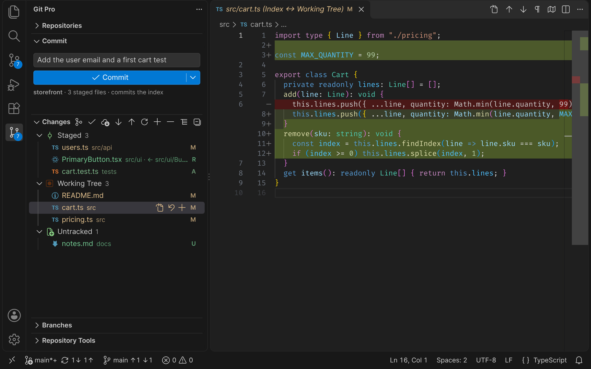
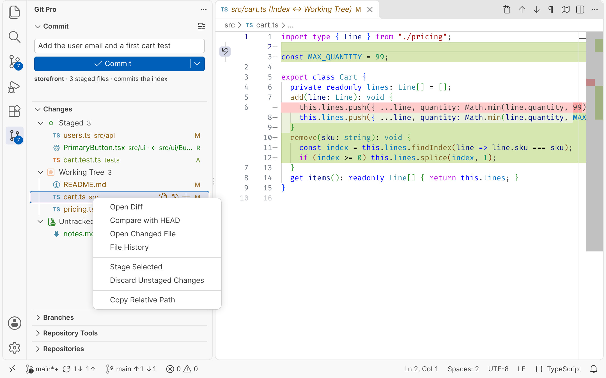
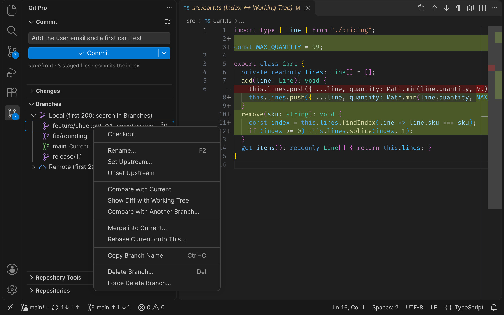
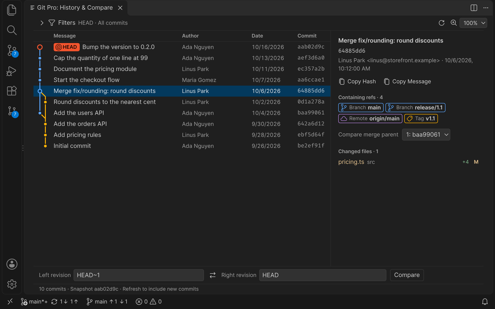
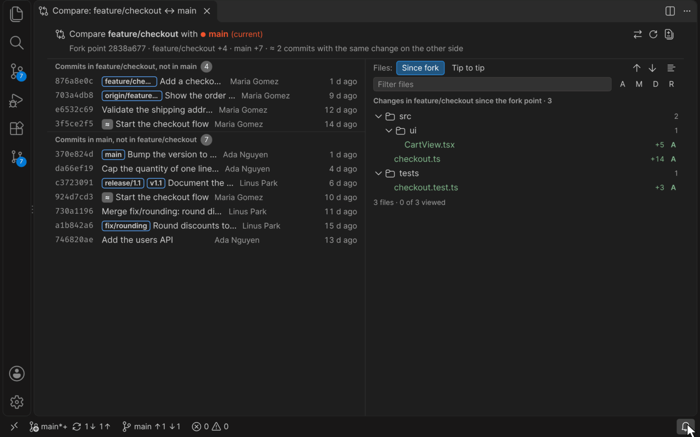
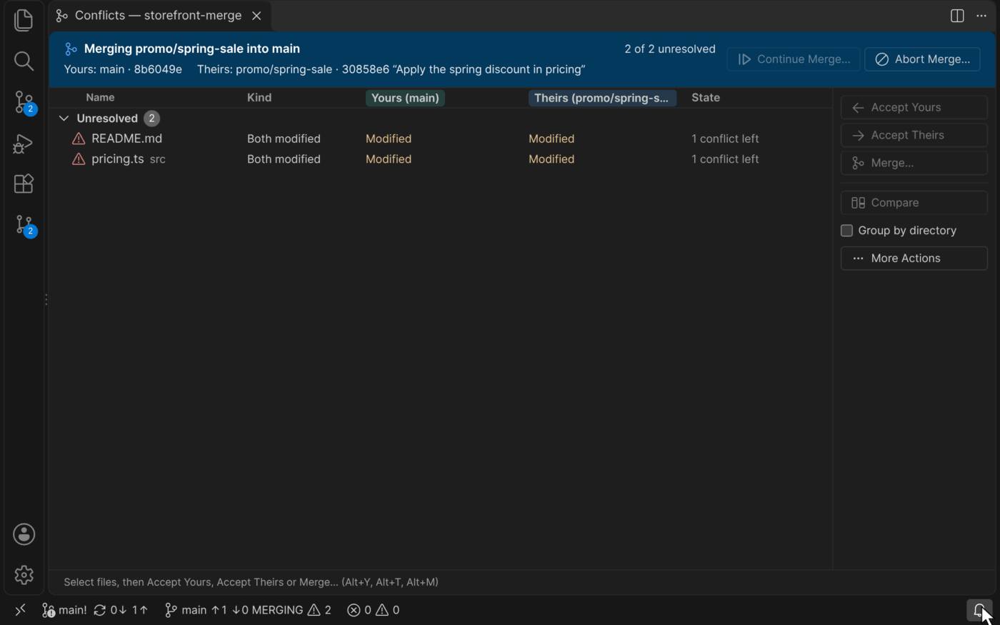

# Git Pro

Review changes, commit, browse History, compare branches, resolve merge conflicts and recover a stopped rebase, all from one Git sidebar in VS Code.

Website: [git-pro.longtd.me](https://git-pro.longtd.me/) · Source: [github.com/nhech/git-pro](https://github.com/nhech/git-pro)

Requirements and known limits are in [compatibility and limitations](docs/user-guide/RELEASE_STATUS.md), and measured timings and bounds in [performance](docs/user-guide/PERFORMANCE.md). Report problems on [GitHub Issues](https://github.com/nhech/git-pro/issues).

## See Git Pro in action

Screenshots use a demo repository in VS Code with dark and light themes. Layout varies with the VS Code version and window width.

### Review, stage and commit

See staged, modified and untracked files at a glance in VS Code's own tree. Type a message in the Commit box above Changes and press Ctrl+Enter (⌘Enter on macOS) or Commit; the menu beside Commit offers Commit & Push, Amend, Sign-off, Skip hooks, Conventional Commits (a type, a scope and a `!`) and message history.

### File actions where you need them

Hover or select a file for inline Open Changes, Open File, Discard and Stage buttons, or right-click it for its diff, comparison with HEAD, history, staging, relative path and a reviewed discard. Available actions follow the file's state.

### Know where each branch stands

Every local branch shows how far it is ahead of or behind its upstream. Right-click a branch to check it out, rename it, set its upstream, compare it, merge it, rebase onto it or delete it.

### Browse History and compare revisions

Follow the commit graph, select a commit for details and changed files, or compare revisions without leaving VS Code. Right-click a commit to check it out, branch or tag from it, cherry-pick, revert, start an interactive rebase from it or compare it with the current branch or the working tree.

### Review a branch like a pull request

Compare any two branches, tags or revisions: the commits on each side, with cherry-picked copies marked ≈, and the changed files as a nested tree. Mark files as viewed as you go; the marks are kept for that comparison.

### Resolve conflicts in one place

When a merge, pull or rebase stops on conflicts, Yours and Theirs are named after their branches. Accept a side for many files at once, or open Merge… in VS Code's merge editor.

## Get started

Requires VS Code 1.100.0 or newer, Git 2.32 or newer and VS Code's built-in Git extension.

1. Install **Git Pro** from the Extensions view, or run **Extensions: Install from VSIX...** for a downloaded package.
2. Open a trusted repository folder, then select **Git Pro** in the Activity Bar.
3. Review changes, stage the files you want, type a message in the Commit box and press Ctrl+Enter (⌘Enter on macOS).

Selecting a file does not stage it. The composer commits the current index, including partial staging performed in native Source Control.

## Features

| Area | Workflows |
|---|---|
| Changes and commits | A native Changes tree with file and folder staging, native diffs, reviewed discard, commit, amend and signoff |
| Branches and sync | Branch and upstream actions from the view's own right-click menu, how far each branch is ahead of or behind its upstream, fetch, explicit pull strategy, push, init and clone |
| History | Commit graph, filters, details, merge-parent selection, comparison and rename-aware File History; commit actions in the right-click menu |
| File review | Text hunk actions, saved-file commits, whole-file blame in the gutter with age colours and a hover card, optional active-line blame and CodeLens |
| Conflicts | Conflicts tab with Yours/Theirs by branch, bulk Accept Yours/Theirs, Merge… in VS Code's merge editor, Continue/Abort banner |
| Compare | Any branch, tag or revision such as `HEAD~3` against another; a branch, tag or revision against the working tree or one folder of it; commits on each side, with cherry-picked copies marked; changed files as a nested tree with diffs opened beside the list and files marked as viewed; Open All Changes; Get from Branch |
| Advanced operations | Merge, rebase, cherry-pick, revert, reset and operation recovery; interactive linear rebase with a right-click menu on each step |
| Repository tools | Stashes, tags, remotes and worktrees, each with its own right-click menu |

Right-click menus are VS Code's own, so they look and behave like the rest of the workbench. Hover a row for inline actions. Icons, theme colors and right-aligned status labels distinguish changes. Discard, delete, reset, rebase and force push show what they will do and ask first. Auto-fetch, blame and CodeLens are off by default.

If you come from a JetBrains IDE: the Conflicts tab names the two sides Yours and Theirs, as the merge tool of those IDEs does, and offers Accept Yours, Accept Theirs and Merge… for the files you select. JetBrains, IntelliJ IDEA and WebStorm are trademarks of JetBrains s.r.o. Git Pro is an independent project, not affiliated with or endorsed by JetBrains.

Read [getting started](docs/user-guide/GETTING_STARTED.md), [workflows and recovery](docs/user-guide/WORKFLOWS.md) and [settings](docs/user-guide/SETTINGS.md).

## License

MIT, copyright 2026 longtd. See `LICENSE` in the source repository or `LICENSE.txt` in the installed package. Third-party attribution is retained in [THIRD_PARTY_NOTICES.txt](THIRD_PARTY_NOTICES.txt).
